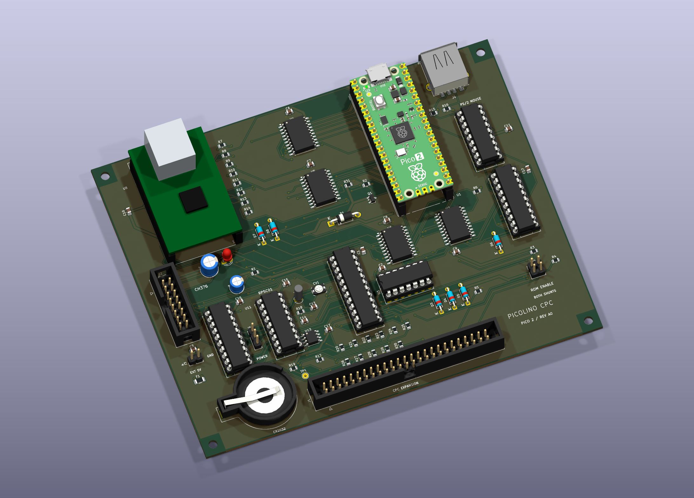

# Picolino CPC

A new combined expansion board for the Amstrad CPC, built around a
**Raspberry Pi Pico 2 / RP2350**.

Development branch: `design/pico2-prototype`.
[Implementation issue #1](https://github.com/salvogendut/picolino-CPC/issues/1).



Revision A0 is a **150 × 120 mm, two-layer prototype**. The image is a KiCad
render of the routed design. The W5100S model is a simplified envelope; the
external CH376 module, ribbon cables, shunts and battery cell are not shown.

## Design files

- [KiCad 10 project](hardware/kicad/picolino-cpc.kicad_pro),
  [schematic](hardware/kicad/picolino-cpc.kicad_sch) and
  [PCB](hardware/kicad/picolino-cpc.kicad_pcb).
- [Five-page schematic PDF](hardware/kicad/picolino-cpc-schematic.pdf),
  [BOM](hardware/kicad/bom.csv) and [top assembly drawing](hardware/kicad/picolino-cpc-assembly.svg).
- [3D perspective](docs/images/picolino-cpc-3d.png) and
  [top view](docs/images/picolino-cpc-top.png).
- [Connections, jumper settings and assembly notes](hardware/README.md).

Open the project after cloning the whole repository. Symbols, footprints and
3D models use project-relative paths and are included locally.

| Function | Selected hardware | Intended connection |
| --- | --- | --- |
| ROM emulation | Socketed Pico 2 | CPC memory bus through level translation |
| USB storage | CH376 parallel USB host module | CPC I/O bus, `FE80` / `FE81` |
| Ethernet | **W5100S** parallel module | CPC I/O bus, `FD20`–`FD23` |
| Mouse | PIC16F84A and 74HCT244 | Cyboard mouse interface, `FD10` |
| RTC | Ricoh RP5C01, DIP-18, and CR2032 holder | New nibble-wide RTC interface |
| Address decoding | GAL20V8 and 74HCT21 | Full 16-bit peripheral decoding |

This is the combined-board project. The earlier Cyboard wired POC and its
unfinished RP2040-only carrier are references, not the Picolino PCB.

## Current state

The repository contains the component/compatibility specification, source
provenance, checked interface data, a revised GAL design, the existing PIC mouse
firmware and CH376 diagnostic, and an RP2350-native bus-monitor firmware target.
The monitor deliberately leaves every CPC-facing GPIO as an input. It is a
bring-up tool, **not the completed ROM emulator**.

Revision A uses the reference projects' parallel modules and the original RP5C01
in DIP-18, as confirmed on 2026-10-07. The complete schematic and routed PCB are
included. **This is an untested prototype, not a fabrication release.** Physical
module fit, power sequencing, RTC calibration and CPC bus timing still require
bench validation. Keep both ROM-enable shunts removed with the monitor firmware.
Track implementation in [the design plan](docs/design-plan.md), and read
[the architecture](docs/architecture.md) before connecting hardware.

## Compatibility

- Ethernet and mouse retain the Cyboard register interfaces. Physical regression
  tests remain necessary.
- CH376 uses its own USB-storage protocol; it does not emulate a CF/ATA drive.
- RP5C01 is **not register-compatible with DS12887/Symbiface RTC software**.
  The new driver must read/write 4-bit registers, select banks and handle BCD.
- The inherited PIC firmware speaks **PS/2 mouse protocol**. A USB-shaped mouse
  connector only works with mice supporting that protocol; it is not USB HID.
- Pico 2 needs an RP2350 firmware build. The old RP2040 UF2 and custom linker
  script must not be reused as Pico 2 firmware.

## Software checks

```sh
python3 tools/build_legacy.py --galasm /path/to/galasm --rasm /path/to/rasm
python3 tests/test_decode.py
python3 tests/test_interfaces.py
python3 tests/test_ch376.py   # requires z80==1.0.0
python3 tools/check_hardware.py  # checks the exported KiCad netlist
```

Build the Pico 2 monitor using Pico SDK 2.2.0 and an Arm embedded toolchain:

```sh
cmake -S firmware/pico2 -B build/pico2 -DPICO_BOARD=pico2 \
  -DPICO_SDK_PATH=/path/to/pico-sdk \
  -DPICO_TOOLCHAIN_PATH=/path/to/arm-gnu-toolchain
cmake --build build/pico2 --parallel
```

Use the Arm Cortex-M33 target for this initial revision. Keep hardware ROM enable
off when using the monitor: it never supplies CPC ROM data. USB serial at the
Pico's own USB connector reports bus snapshots and the actual system clock.
The CH376's USB host connector is separate.

See [sources and licensing](docs/sources.md). No CPC OS/BASIC ROMs are included.
Recorded tool versions, results and remaining checks are in
[validation.md](docs/validation.md).
