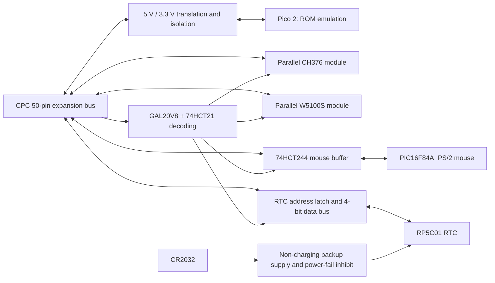

# Picolino architecture, revision A draft

The selected product is a single combined board. Its reference sources are
Cyboard for the bus, Ethernet and mouse, CPC_PICOROM for ROM emulation, and the
Ricoh RTC documentation for the replacement clock subsystem.

## Pico 2

Use an original Pico 2 module, socketed for replacement and isolated programming.
RP2350 provides Cortex-M33 cores, 520 kB SRAM and the Pico 2's 4 MB flash. It still
exposes 26 GPIOs: the larger MCU does not remove the bus pin-allocation constraint.
Keep the initial CPC_PICOROM allocation: GPIO0–13 address A0–13, GPIO14–21 data,
GPIO22 `/ROMEN`, GPIO26 A15, GPIO27 ROM-selection strobe and GPIO28 reset pull-down.
The firmware header and machine-readable interface list record physical pins
separately from GPIO numbers.

Retain external translation/isolation. In particular, the Pico 2 datasheet limits
ADC-capable GPIO26–28 to the I/O supply plus approximately 0.3 V. All CPC-facing
lines must remain safe during power sequencing and disabled operation. ROM enable
must both control ROMDIS and isolate data outputs; default to internal CPC ROMs.

The first firmware milestone is a native Pico 2 input-only bus monitor, at the
SDK's normal clock. Port the ROM service separately, using the RP2350 memory map
and SDK startup code. Do not copy the RP2040 256 kB linker layout, 2 MB flash
partition or assume the upstream 250 MHz overclock is appropriate for Pico 2.
More SRAM can increase ROM capacity after budgeting firmware, stacks and buffers.
Scope measurements decide whether the ROM loop/PIO design meets CPC timing.

## Storage, Ethernet and mouse

The CPC accesses the parallel CH376 and W5100S directly. They do not consume
Pico GPIOs or interrupt its ROM-serving loop. GAL decoding keeps existing
mouse/Ethernet software interfaces. The reference module connections were
selected by the user on 2026-10-07. Extract their connector geometry from the
reference CAD and check module clearance before laying out the combined board.

W5100S is the intended part (the initial request called it WS5100s). A module
exposing only SPI, such as WIZ810Sio, does not provide the required parallel bus.
Cyboard's reference module includes its own 3.3 V regulator and uses 470-ohm data
series resistors plus its documented read/write conditioning. Retain that circuit
for the selected reference module. The original CF mode resistors R12/R13 belong
to the removed CF subsystem and are not part of the Ethernet interface.

Reuse the PIC16F84A firmware unchanged initially, including the CPC 4 MHz clock,
reset, mouse pull-ups and 74HCT244 output buffer. Preserve the actual PIC-to-buffer
pin mapping rather than assuming PORTB maps directly to D0–D7. If a USB-A socket
is retained for the mouse, label it PS/2 MOUSE to distinguish it from CH376 USB.

## Proposed I/O map

| Address | Read | Write |
| --- | --- | --- |
| `FD10` | PIC mouse response | Unselected |
| `FD14` | RP5C01 low nibble | RP5C01 low nibble |
| `FD15` | Unselected | RTC register index, low nibble |
| `FD20`–`FD23` | W5100S indirect registers | W5100S indirect registers |
| `FE80` | CH376 data | CH376 data |
| `FE81` | CH376 interface status | CH376 command |

The RTC ports reuse the earlier address pair to avoid extra decoding, but their
contents now follow RP5C01. This is an explicit RTC ABI change; no DS12887
compatibility claim is made. RTC software masks all reads with `0x0F` because
the chip drives only D0–D3. Avoid block Z80 I/O instructions that change B when
accessing a fully decoded 16-bit port.

## RP5C01 and CR2032

The RTC is a separate 5 V peripheral with 4-bit addresses and data. A candidate
74HCT373 address latch stores D0–D3 on a write to FD15; its transparent enable
closes at the end of the write. Unused inputs are tied to defined levels.
Qualified read/write strobes and a chip-select control FD14 accesses. The GAL's
previously unused CF A3 output becomes RTC chip select; no CF connector remains.

The battery supplies only the RTC backup domain. Use a non-charging backup
switch and a power-fail signal that disables RTC bus access during supply loss.
Budget the voltage drop in the RTC feed against the original RP5C01's 4.5–5.5 V
normal-access range. The backup network must also prevent RTC-powered outputs
from feeding unpowered bus logic. Pin 1 is active-low `/CS` from the GAL;
pin 2 is active-high `CS` from the power-fail detector, held low during backup.
Input biasing must prevent floating inputs when the main board loses power.

The selected original RP5C01 specifies 2.2 V minimum backup voltage and needs an
external 32.768 kHz crystal network. Use its original manufacturer application
circuit, including the resistor and adjustable capacitance, rather than assuming
RP5C01A values apply. Choose the crystal and load network together and measure
startup, frequency and backup current. Use a CR2032 holder with a verified
footprint and clear polarity; there is no charging circuit.

The ADM691A-based circuit in the reference RTC project is useful for studying
switchover and write inhibition. It is not yet a selected Picolino BOM item:
Analog Devices currently marks ADM691A as last-time-buy. Select and verify the
backup supervisor independently before committing the RTC schematic.

## Power and mechanics

The PCB needs explicit budgets for Pico 2, W5100S, USB-stick inrush and mouse
power. Reserve an external regulated 5 V option and prevent it from feeding
back into the CPC or Pico USB supply. The coin cell must not feed these loads.

Use the CPC expansion connector directly; there is no CF-socket wiring. The
combined-board envelope, module orientation, battery access, connector style
and mounting holes are the next mechanical design decisions.
The previous small-board outline must not be treated as a combined-board layout.

Primary sources are linked in [sources.md](sources.md).
